# Continuous Integration Testing Processes

This document provides a comprehensive overview of our Continuous Integration (CI) testing processes. It explains when and how different test jobs are triggered, where to monitor them, and details about the environments hosting these tests, along with guidance on how to access them.

## GitHub Pull Requests

When a new Pull Request (PR) is opened at [rhdh](https://github.com/redhat-developer/rhdh), tests are triggered based on the nature of the changes and the contributor's role.

### How PRs Are Tested and Merged

The mandatory `e2e-ocp-helm` check claims an ephemeral OpenShift cluster on every run, so it does not run on every push. It is a second-stage job of the OpenShift CI [pipeline controller](https://docs.ci.openshift.org/docs/how-tos/creating-a-pipeline/), which every branch of this repo (`main` and all `release-*`) uses in **LGTM mode**: the job starts when a PR is approved, and it must pass before the PR merges.

#### The Pieces

| Piece                        | What it does                                                                                                                                                                                                                      |
| ---------------------------- | --------------------------------------------------------------------------------------------------------------------------------------------------------------------------------------------------------------------------------- |
| **Prow**                     | OpenShift CI's GitHub automation. It runs presubmit jobs, handles `/test`, `/lgtm`, `/approve`, `/hold` and other comment commands, and manages the matching labels.                                                              |
| **Tide**                     | Prow's merge bot (`openshift-merge-bot`). It merges a PR once the PR matches a Tide query and its required checks are green.                                                                                                      |
| **`lgtm` label**             | Added by an approving review or `/lgtm`, removed by any new push. Tide merges PRs that have it. In this repo it is also the signal that starts `e2e-ocp-helm`.                                                                    |
| **Pipeline controller**      | Watches for `lgtm`. When it is added, it comments `/test e2e-ocp-helm`, unless the job already ran on this commit or the change does not need a cluster.                                                                          |
| **`ci/pipeline-gate` check** | Published by the pipeline controller, and required for merge on every protected branch. It turns green once the controller has started the jobs that apply, or when none apply. It is per commit, so a new push needs a new gate. |
| **`e2e-ocp-helm` check**     | The mandatory e2e job. It is not started on push, but once it has started, it must pass before merge.                                                                                                                             |
| **Auto-approve workflow**    | [`auto-approve-bot-prs.yaml`](../../.github/workflows/auto-approve-bot-prs.yaml). It labels and approves eligible bot PRs (see [Bot PRs](#bot-prs)).                                                                              |
| **`skip-e2e` label**         | Added only by the auto-approve workflow to `[skip-e2e]` PRs from `rhdh-bot`. Tide merges `rhdh-bot` PRs that have it without `lgtm`. It has no effect on other PRs. Do not add it by hand.                                        |

#### Contributor PRs

1. **Push:** the fast checks (lint, unit tests, image build and so on) run as usual. `e2e-ocp-helm` does not start. The PR cannot merge yet because `ci/pipeline-gate` is required and not reported.
2. **Optional early run:** comment `/test e2e-ocp-helm` at any time to get e2e results before review.
3. **Approval:** an approving review adds `lgtm`, and the pipeline controller then does one of three things:
   - **Every changed file is docs, repository tooling, AI agent config, the cluster-free e2e harness or CI for other platforms:** it turns `ci/pipeline-gate` green and starts nothing. The `pipeline_skip_if_only_changed` pattern in the job's [openshift/release config](https://github.com/openshift/release/tree/main/ci-operator/config/redhat-developer/rhdh) lists these paths.
   - **`e2e-ocp-helm` already ran on this commit** (for example from step 2): it turns the gate green and does not run the job again.
   - **Otherwise:** it comments `/test e2e-ocp-helm` and turns the gate green.
4. **Merge:** once `e2e-ocp-helm` passes (if it ran), Tide merges the PR. The job is not re-run when the base branch moves.
5. **New push after approval:** the push removes `lgtm`, so the next approval runs `e2e-ocp-helm` again on the new commit.

Draft PRs are not usually approved, so `e2e-ocp-helm` does not run on them unless someone comments `/test e2e-ocp-helm`.

#### Bot PRs

The auto-approve workflow handles PRs from `rhdh-bot` and `rhdh-gh-app[bot]` on `chore/automated-*` branches (base-image updates, version bumps and similar). No human is involved: the workflow approves the PR and adds the merge label, and Tide merges it.

| Bot PR                                                                           | What the workflow adds                                                                                                                                                            | Does `e2e-ocp-helm` run?                    |
| -------------------------------------------------------------------------------- | --------------------------------------------------------------------------------------------------------------------------------------------------------------------------------- | ------------------------------------------- |
| `rhdh-bot`, title contains `[skip-e2e]`                                          | `rhdh-bot` comments `/pipeline mark-pipeline-gate <HEAD SHA>`, which turns `ci/pipeline-gate` green for that commit, then the workflow adds `skip-e2e` and `approved` (no `lgtm`) | No, and no cluster is claimed               |
| `rhdh-bot` `[skip-e2e]` PR whose gate is not green within two minutes (fallback) | `lgtm` and `approved`                                                                                                                                                             | Yes, but it exits early on `[skip-e2e]`     |
| `rhdh-bot` or `rhdh-gh-app[bot]` without `[skip-e2e]`                            | `lgtm` and `approved`                                                                                                                                                             | Yes                                         |
| `rhdh-gh-app[bot]` with `[skip-e2e]`                                             | `lgtm` and `approved`                                                                                                                                                             | Yes, but it exits early on `[skip-e2e]`     |
| Any other bot PR (not on a `chore/automated-*` branch)                           | Nothing                                                                                                                                                                           | Reviewed and approved like a contributor PR |

`pull_request_target` runs the workflow file from the PR's base branch, so a change to it applies to `release-*` branches only after it is backported there.

#### Commands

| Command                 | When to use it                                                                                                  |
| ----------------------- | --------------------------------------------------------------------------------------------------------------- |
| `/test e2e-ocp-helm`    | Get e2e results before review, or re-run a failed run                                                           |
| `/pipeline remaining`   | `ci/pipeline-gate` is missing or stuck on an approved PR: starts any job that has not run on the current commit |
| `/pipeline help`        | Lists the other pipeline-controller commands                                                                    |
| `/hold`, `/hold cancel` | Stop or allow Tide merging the PR                                                                               |

#### Troubleshooting a PR That Does Not Merge

| Symptom                                                | Likely cause                                                                                                             | Fix                                                                                                         |
| ------------------------------------------------------ | ------------------------------------------------------------------------------------------------------------------------ | ----------------------------------------------------------------------------------------------------------- |
| `ci/pipeline-gate` is "Expected — waiting for status"  | The PR has not been approved on its current commit, or it was approved before this repo moved to the pipeline controller | Get an approving review, or comment `/pipeline remaining`                                                   |
| `ci/pipeline-gate` is green but `e2e-ocp-helm` failed  | The test failed                                                                                                          | Fix it, or comment `/test e2e-ocp-helm` to retry a flake                                                    |
| A `[skip-e2e]` bot PR has `skip-e2e` but no green gate | A push after the workflow ran, or the controller did not process the comment                                             | Re-run the auto-approve workflow, or comment `/lgtm` so it takes the normal path (e2e runs and exits early) |
| Everything is green but nothing merges                 | A blocking label: `do-not-merge/hold`, `do-not-merge/work-in-progress`, `jira/invalid-bug` and similar                   | Remove the label, or comment `/hold cancel`                                                                 |

#### Where This Is Configured

| What                                                                                      | Where                                                                                                                                                                                                                   |
| ----------------------------------------------------------------------------------------- | ----------------------------------------------------------------------------------------------------------------------------------------------------------------------------------------------------------------------- |
| Pipeline-controller enrolment (LGTM mode, all branches)                                   | [`core-services/pipeline-controller/lgtm-config.yaml`](https://github.com/openshift/release/blob/main/core-services/pipeline-controller/lgtm-config.yaml) in openshift/release                                          |
| Required `ci/pipeline-gate`, Tide queries (`lgtm`; `rhdh-bot` + `skip-e2e`), merge method | [`core-services/prow/02_config/redhat-developer/rhdh/_prowconfig.yaml`](https://github.com/openshift/release/blob/main/core-services/prow/02_config/redhat-developer/rhdh/_prowconfig.yaml) in openshift/release        |
| `e2e-ocp-helm` job and its `pipeline_skip_if_only_changed` pattern                        | [`ci-operator/config/redhat-developer/rhdh/`](https://github.com/openshift/release/tree/main/ci-operator/config/redhat-developer/rhdh) in openshift/release                                                             |
| The early exit on `[skip-e2e]`                                                            | [`redhat-developer-rhdh-ocp-helm-commands.sh`](https://github.com/openshift/release/blob/main/ci-operator/step-registry/redhat-developer/rhdh/ocp/helm/redhat-developer-rhdh-ocp-helm-commands.sh) in openshift/release |
| Bot PR labelling and approval                                                             | [`.github/workflows/auto-approve-bot-prs.yaml`](../../.github/workflows/auto-approve-bot-prs.yaml) in this repo                                                                                                         |

### Manual Triggering of Tests

For scenarios where tests are not automatically triggered, or when you need to manually initiate tests (e.g., for draft PRs or external contributions), you can use the following commands:

1. **Commenting `/ok-to-test`:**
   - **Purpose:** This command is used to validate a PR for testing, especially important for external contributors or when tests are not automatically triggered.
   - **Who Can Use It:** Only members of both the [openshift](https://github.com/openshift) and [redhat-developer](https://github.com/redhat-developer) GitHub organizations can mark the PR with this comment.
   - **Use Cases:**
     - **External Contributors:** For PRs from contributors outside the organization, a member needs to comment `/ok-to-test` to initiate tests.
   - **More Details:** For additional information about `/ok-to-test`, please refer to the [Kubernetes Community Pull Requests Guide](https://github.com/kubernetes/community/blob/master/contributors/guide/pull-requests.md#more-about-ok-to-test).

2. **Triggering Tests Post-Validation:**
   - After an `openshift` and `redhat-developer` org member has validated the PR with `/ok-to-test`, anyone can trigger tests using the following commands:
     - `/test ?` to get a list of all available jobs
     - `/test e2e-ocp-helm` for mandatory PR checks
   - **Note:** Avoid using `/test all` as it may trigger unnecessary jobs and consume CI resources. Instead, use `/test ?` to see available options and trigger only the specific tests you need.
3. **Triggering Optional Nightly Job Execution on Pull Requests:**
   The following optional nightly jobs can be manually triggered on PRs targeting the `main` branch and `release-*` branches. These jobs help validate changes across various deployment environments by commenting the trigger command on PR.

   **Job Name Format:** Jobs follow the naming scheme `redhat-developer-rhdh-PLATFORM-[VERSION]-INSTALL_METHOD-[SPECIAL_TEST]-nightly` where:
   - `PLATFORM`: The target platform (e.g., `ocp`, `aks`, `gke`)
   - `VERSION`: The platform version (e.g., `v4-17`, `v4-18`, `v4-19`)
   - `INSTALL_METHOD`: The deployment method (e.g., `helm`, `operator`)
   - `SPECIAL_TEST`: Optional special test type (e.g., `upgrade`)

   Use `/test ?` to see the complete list of available jobs for your specific branch and PR context.

These interactions are picked up by the OpenShift-CI service, which sets up a test environment. The configurations and steps for setting up this environment are defined in the `openshift-ci-tests.sh` script. For more details, see the [High-Level Overview of `openshift-ci-tests.sh`](#high-level-overview-of-openshift-ci-testssh).

### Retrying Tests

If the initial automatically triggered tests fail, OpenShift-CI will add a comment to the PR with information on how to retrigger the tests.

### CI Job Definitions

#### Pull Request Test Job

- **Purpose:** Validate new PRs for code quality, functionality, and integration.
- **Trigger:**
  - **Automatic:** When the PR gets `lgtm`, the pipeline controller triggers `e2e-ocp-helm`, unless every changed file matches its `pipeline_skip_if_only_changed` pattern.
  - **Manual:** When `/ok-to-test` is commented by an `openshift` and `redhat-developer` org member for external contributors or when `/test`, `/test images`, or `/test e2e-ocp-helm` is commented after validation.
- **Environment:** Runs on ephemeral OpenShift clusters managed by Hive. Kubernetes jobs use ephemeral EKS and AKS clusters on spot instances managed by [Mapt](https://github.com/redhat-developer/mapt). GKE uses a long-running cluster.
- **Configurations:**
  - Tests are executed on both **RBAC** (Role-Based Access Control) and **non-RBAC** namespaces. Different sets of tests are executed for both the **non-RBAC RHDH instance** and the **RBAC RHDH instance**, each deployed in separate namespaces.
- **Access:** In order to access the environment, you can run the bash at `.ci/pipelines/ocp-cluster-claim-login.sh`. You will be prompted for the Prow URL (the URL from the OpenShift agent, which looks like https://prow.ci.openshift.org/...). Once you have claimed a cluster, this script will forward the cluster web console URL along with the credentials.
- **Steps:**
  1. **Detection:** OpenShift-CI detects the PR event.
  2. **Environment Setup:** The test environment is set up using the `openshift-ci-tests.sh` script (see the [High-Level Overview](#high-level-overview-of-openshift-ci-testssh)).
     - **Cluster Configuration:** Sets up the required namespaces and applies necessary configurations and secrets.
     - **Application Deployment:** Deploys the RHDH instances using Helm charts, tailored to the specific test scenarios.
  3. **Test Execution:**
     - **Running Tests:** Executes test suites using `yarn playwright test --project=<project-name>` directly.
     - **Retry Logic:** Individual tests are retried up to 2 times as specified in the Playwright configuration.
     - **Note:** Orchestrator infra setup and subsequent associated tests are excluded from the mandatory PR job (`/test e2e-ocp-helm`) and run in nightly jobs instead.
  4. **Artifact Collection:**
     - Collects test artifacts (logs, screenshots, recordings).
     - Stores artifacts in the designated `ARTIFACT_DIR` for a retention period of **6 months**.
     - The reports are also sent to _ReportPortal_
  5. **Reporting:**
     - Reports status back to the PR checks.
     - Generates and uploads HTML reports.

- **Artifacts:** Test reports, logs, screenshots, accessible via PR details under **Artifacts**.
- **Notifications:** Status updates posted on the PR.

### GitHub PR Testing Diagram

## Nightly Tests

Nightly tests are run to ensure the stability and reliability of our codebase over time. These tests are executed on different clusters to cover various environments, including both **RBAC** and **non-RBAC**.

### Nightly Test Environments

- **OCP Nightly Tests:** Run on ephemeral OpenShift clusters provisioned via Hive cluster pools on AWS. Multiple OCP versions are tested.
- **OCP Operator Nightly Tests:** Same as OCP nightly but deploy RHDH using the Operator instead of Helm.
- **AKS Nightly Tests:** Nightly tests on Azure Kubernetes Service (AKS) using ephemeral clusters provisioned by [Mapt](https://github.com/redhat-developer/mapt). AKS is exclusively used for nightly runs (no PR checks).
- **EKS Nightly Tests:** Nightly tests on AWS Elastic Kubernetes Service (EKS) using ephemeral clusters provisioned by Mapt.
- **GKE Nightly Tests:** Nightly tests on Google Kubernetes Engine using a long-running shared cluster.
- **OSD-GCP Nightly Tests:** Nightly tests on OpenShift Dedicated on GCP.

### Additional Nightly Jobs for Main Branch

The nightly job for the `main` branch also runs against three OpenShift Container Platform (OCP) versions to ensure compatibility and stability across multiple versions. We maintain testing on the three most recent OCP versions. As new OCP versions are released, we will update our testing pipeline to include the latest versions and drop support for older ones accordingly.

> **Note:** The output of the nightly runs, including test results and any relevant notifications, is posted on the Slack channel **`#rhdh-e2e-alerts`**.

### Localization Tests

Localization tests verify that the RHDH UI displays correctly translated strings for supported languages. These tests run in a dedicated `e2e-ocp-helm-localization-nightly` nightly job.

- **Supported Languages:** German (de), Spanish (es), French (fr), Italian (it), and Japanese (ja)
- **When They Run:** Localization tests run in their own nightly job with a dedicated showcase deployment.
- **Playwright Projects:** `showcase-localization-de`, `showcase-localization-es`, `showcase-localization-fr`, `showcase-localization-it`, `showcase-localization-ja`

The localization test implementation is in `.ci/pipelines/jobs/ocp-localization.sh` (`run_localization_tests()` function).

Those projects seed `localStorage.language` and keep deploy `defaultLanguage: en`. Coverage for a non-English `defaultLanguage` (no stored language) lives in the cluster-free harness — see [default-language.md](./default-language.md).

### CI Job Definitions

#### Nightly Test Job

- **Purpose:** Ensure ongoing stability and detect regressions in different environments.
- **Trigger:** Scheduled to run every night.
- **Environments:**
  - **OCP:** Ephemeral clusters from Hive pools (multiple OCP versions).
  - **AKS/EKS:** Ephemeral clusters provisioned by [Mapt](https://github.com/redhat-developer/mapt).
  - **GKE:** Long-running shared cluster.
  - **OSD-GCP:** OpenShift Dedicated on GCP.
- **Configurations:**
  - Tests are executed on both **RBAC** (Role-Based Access Control) and **non-RBAC** namespaces.
- **Steps:**
  1. **Triggering:** Nightly job is triggered on schedule.
  2. **Environment Setup:** Uses the `openshift-ci-tests.sh` script for setting up the environment (see the [High-Level Overview](#high-level-overview-of-openshift-ci-testssh) for more information).
     - **Cluster Selection:** Chooses the appropriate cluster and OCP version based on the job configuration.
     - **Resource Configuration:** Sets up namespaces and configures resources.
     - **Deployment:** Deploys the Red Hat Developer Hub (RHDH) instance and necessary services.
  3. **Test Execution:**
     - Runs full test suites using `yarn playwright test --project=<project-name>` directly.
     - Tests are executed similarly to the PR tests but may include additional suites.
     - **Retry Logic:** Individual tests are retried up to 2 times as specified in the Playwright configuration.
  4. **Artifact Collection:**
     - Collects and aggregates results.
     - Stores artifacts for later review for a retention period of **6 months**.
  5. **Reporting:**
     - Posts outputs to Slack channel `#rhdh-e2e-alerts`.
     - Generates report.
- **Artifacts:** Comprehensive test reports, logs, screenshots.
- **Notifications:** Results posted on Slack.

> **Note:** The nightly testing diagram below is a simplified overview. For detailed job types, failure investigation, and triage workflows, see the [CI Medic Guide](CI-medic-guide.md).

### Nightly Testing Diagram

## Configuration and Installation of Testing Environments

### Automation Processes

- **Script Used:**
  - **`openshift-ci-tests.sh`**: Automates the setup of the test environment, deployment of RHDH instances, and execution of tests. For more details, refer to the [High-Level Overview of `openshift-ci-tests.sh`](#high-level-overview-of-openshift-ci-testssh).

### High-Level Overview of `openshift-ci-tests.sh`

The `openshift-ci-tests.sh` script (located at [`.ci/pipelines/openshift-ci-tests.sh`](../../.ci/pipelines/openshift-ci-tests.sh)) orchestrates the deployment and testing workflow for both PR and nightly jobs. The configuration for the Red Hat Developer Hub instance is managed using `yaml` config files for the application itself and the plugins in use. Those files are located in `.ci/pipelines/resources`. These files define essential setup details and configurations specific to each test instance, ultimately determining the precise environment for the RHDH deployment.

Additionally, a **test runner** based on a custom Docker image (defined in [this Dockerfile](https://github.com/redhat-developer/rhdh/blob/main/.ci/images/Dockerfile)) is set up as part of the environment. This runner helps standardize the testing environment and provides the necessary dependencies for test execution.

The OpenShift CI definitions for PR checks and nightly runs, as well as execution of `openshift-ci-tests.sh`, are managed here:

- [PR checks and nightly job definitions](https://github.com/openshift/release/tree/master/ci-operator/jobs/redhat-developer/rhdh)
- [Configuration definitions](https://github.com/openshift/release/tree/master/ci-operator/config/redhat-developer/rhdh)
- [Step registry for job execution](https://github.com/openshift/release/tree/master/ci-operator/step-registry/redhat-developer/rhdh)

- **Environment Preparation:** Sets up clusters and namespaces based on job requirements.
- **Deployment:** Deploys RHDH instances using Helm charts.
- **Testing:** Runs end-to-end tests with Playwright.
- **Cleanup and Reporting:** Cleans up resources and collects artifacts after testing.

Detailed steps on how the tests and reports are managed can be found in the `testing::run_tests()` and `testing::check_and_test()` functions in `.ci/pipelines/lib/testing.sh`. The CI pipeline executes tests directly using Playwright's `--project` flag (e.g., `yarn playwright test --project=showcase`) rather than yarn script aliases. These functions accept an explicit Playwright project argument, decoupling the namespace from the test project name for more flexible reuse.

### Playwright Project Names (Single Source of Truth)

All Playwright project names are defined in a single JSON file: [`e2e-tests/playwright/projects.json`](../../e2e-tests/playwright/projects.json). This file serves as the single source of truth for:

- **TypeScript** (`playwright.config.ts`): Imports via `e2e-tests/playwright/projects.ts`
- **CI/CD Scripts**: Loaded via `.ci/pipelines/playwright-projects.sh` as `$PW_PROJECT_*` environment variables

When adding or modifying Playwright projects, update `projects.json` first. The project names are automatically available as:

| JSON Key        | Shell Variable              | Value           |
| --------------- | --------------------------- | --------------- |
| `SHOWCASE`      | `$PW_PROJECT_SHOWCASE`      | `showcase`      |
| `SHOWCASE_RBAC` | `$PW_PROJECT_SHOWCASE_RBAC` | `showcase-rbac` |
| `SHOWCASE_K8S`  | `$PW_PROJECT_SHOWCASE_K8S`  | `showcase-k8s`  |
| ...             | ...                         | ...             |

When the test run is complete, the status will be reported under your PR checks.

> **Important:** The environment in which the PR tests are executed is shared and ephemeral. All PR tests queue for the same environment, which is destroyed and recreated for each PR. Test outputs (screenshots, recordings, walkthroughs, etc.) are stored for a retention period of **6 months** and can be accessed by checking the **Details -> Artifacts** of the test check on the PR.

### Automated Steps

- **Environment Setup:**
  - **PR Tests:** Ephemeral environments are automatically created and destroyed per test run.
  - **Nightly Tests:** Use long-running clusters with automated updates, including multiple OCP versions (usually the current and the previous two).
- **Deployment:**
  - RHDH instances are deployed using automated scripts and Helm charts.
- **Test Execution:**
  - Tests are executed using `yarn playwright test --project=<project-name>` directly in CI. Yarn scripts are available for local development.
- **Cleanup:**
  - The script cleans up all temporary resources after tests.
- **Reporting:**
  - Generates reports and stores artifacts for **6 months**.
  - Nightly test results are posted to Slack channel `#rhdh-e2e-alerts`.

### Configuration Details

- **Environment Variables and Secrets:**
  Stored securely in the **OpenShift-CI Vault** and accessed during runtime. Members of the organization can ask its peers for details about where and how to access this information.
- **Cluster Credentials:**
  The script sets cluster URLs, tokens, and selects the appropriate OCP version based on job requirements.
- **Namespace and Resource Management:**
  Handles creation and deletion of namespaces and applies necessary Kubernetes resources.
- **Dependency Management:**
  Installs required tools like `oc`, `kubectl`, and `helm` if not already available.
